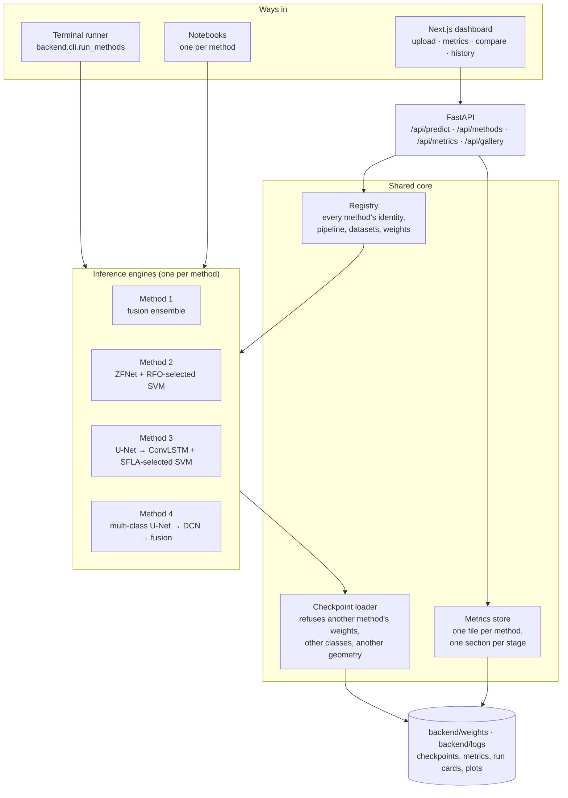
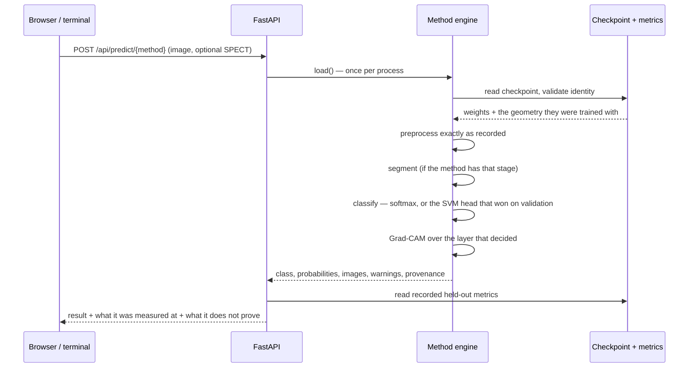
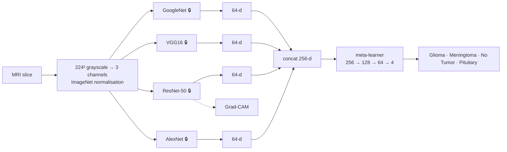
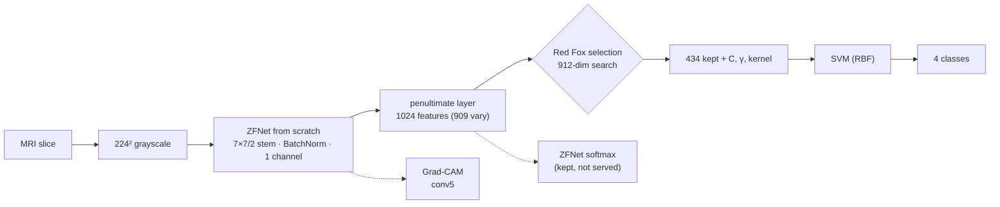
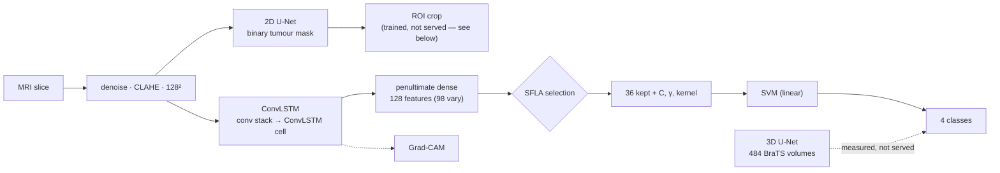
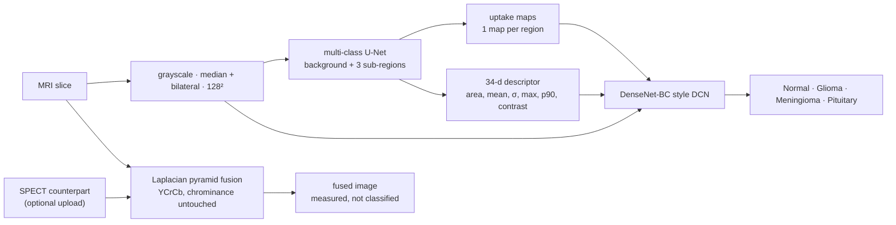

# 🧠 NeuroSeg AI — four brain-tumour methods, honestly measured

Four independent deep-learning pipelines for brain-MRI tumour analysis, each
implemented end to end, each trained and evaluated separately, all served behind
one FastAPI backend and one Next.js dashboard — plus a terminal runner and a set
of notebooks that show what every method produced.

> ⚠️ **Research / decision-support only.** Not a certified medical device, not
> clinically validated, and not to be used to diagnose or treat anyone. Every
> output needs a qualified radiologist's interpretation.

The design goal that shaped most of this repository: **a number that was not
measured is never shown, and a model that was not trained never guesses.** An
untrained method returns `null`, not a class. Every accuracy carries the
warnings its training run recorded. The sections below say what each method
measured, on which data, and what that measurement does *not* support.

---

## Results

All four were evaluated **once** on the same held-out test set — the dataset's own
`Testing/` folder, 1,311 images, never touched during training or model selection.

| # | Method | What actually decides the class | Accuracy | Macro F1 | AUC |
|---|---|---|---|---|---|
| 1 | Pre-trained CNNs + transfer learning | Meta-learner over 4 frozen ImageNet backbones | 95.12 % | 0.9495 | 0.9947 |
| 2 | Red Fox optimised ZFNet | SVM on 434 of 909 Red Fox–selected ZFNet features | **97.64 %** | 0.9761 | 0.9953 |
| 3 | U-Net + ConvLSTM + SFLA | SVM on 36 of 98 SFLA-selected ConvLSTM features | 96.95 % | 0.9697 | 0.9944 |
| 4 | MRI–SPECT fusion | DCN over the slice + per-region uptake maps | 91.38 % | 0.9103 | 0.9874 |

Segmentation, measured on its own held-out data:

| Model | Scope | Dice |
|---|---|---|
| Method 3 · 2D U-Net | binary whole tumour, contrast-enhanced T1 | 0.656 (0.662 on slices that contain tumour) |
| Method 3 · 3D U-Net | binary whole tumour, **volumes** — does not serve uploads | 0.509 over 72 held-out volumes |
| Method 4 · multi-class U-Net | 3 tumour sub-regions | 0.373 mean (oedema 0.595, enhancing 0.280, necrotic 0.243) |

Method 4's fusion stage is deterministic and measured by fusion quality, not
accuracy: **Q_abf 0.708** over 357 registered MRI–SPECT pairs, against 0.392 for
averaging the two images.

**What these numbers do not show.** The classification split is *image-level* —
this dataset ships no patient identifiers — so none of it demonstrates
patient-level generalisation. Method 4's accuracy is its MRI branch classifying
MRI; it says nothing about fused images, because the paired MRI–SPECT data
carries no diagnosis labels. The segmentation and volumetric splits *are*
patient-level.

---

## Quick start

```bash
scripts/setup.sh                 # creates .venv, installs everything, reports what is ready
```

```bash
# every method on one image, with its pictures, in the terminal
.venv/bin/python -m backend.cli.run_methods data/bri/archive/Testing/meningioma/Te-me_0014.jpg
```

```bash
# the web app
.venv/bin/python -m uvicorn backend.main:app --reload --port 8000   # API + /docs
cd frontend && npm install && npm run dev                           # http://localhost:3000
```

Everything runs on a fresh clone: the trained checkpoints are in the repository
and a few sample images come with it, so nothing needs downloading first. Use
`.venv/bin/python` rather than `python` (macOS has no `python` on PATH), or run
`source .venv/bin/activate` once per terminal.

**No Python on the target machine?** Use Docker — the image carries Python,
torch and the trained models:

```bash
docker compose up --build        # http://localhost:3000
```

[DOCKER.md](DOCKER.md) covers sending it to another machine, including the
architecture trap: an image built on Apple Silicon will not start on a normal PC.

<details>
<summary><b>If setup fails</b></summary>

`scripts/setup.sh` prints your Python version and CPU architecture first,
because that pair is what usually breaks.

| what you see | why | what happens |
|---|---|---|
| `python: command not found` | macOS ships `python3` only | use `.venv/bin/python`, or `source .venv/bin/activate` |
| `No matching distribution found for torch (from versions: none)` | no torch wheel exists for that Python + CPU; PyTorch's last Intel-Mac build (2.2.2) supports Python 3.8–3.11, so 3.12+ on Intel can never work | the script looks for a Python that can, in `/Library/Frameworks`, `/usr/local/bin`, `/opt/homebrew/bin` |
| `Cache entry deserialization failed` | a half-written pip cache | the script purges it and retries once |
| `no usable Python found` | nothing on the machine is 3.10–3.13 | it lists the interpreters you *do* have, and two ways to install one |

With no Homebrew, either works and neither needs admin tooling:

```bash
open https://www.python.org/downloads/macos/   # latest 3.12.x (3.11.x on Intel)
# or
curl -LsSf https://astral.sh/uv/install.sh | sh && ~/.local/bin/uv python install 3.12
```
</details>

---

## System architecture



Three properties hold throughout, and most of the code exists to keep them:

**1 · A checkpoint carries its own identity.** Every saved model records the
method it belongs to, its architecture, its role, its class names and the exact
preprocessing geometry it was trained with. Loading validates all of it, so one
method's weights can never be served by another, and a model trained on whole
slices is never fed ROI crops.

**2 · Metrics are read, never computed at request time.** The API, the UI, the
terminal runner and the notebooks all read the same metrics files written by the
training runs. They cannot disagree with each other, and nothing can quietly
"recompute" a nicer number.

**3 · Warnings travel with results.** Each run records what is wrong with it —
an image-level split, a borrowed mask, a mediocre segmentation feeding a feature
stage — and those sentences follow the number into the API response, the
dashboard, the PDF report and the notebooks.

### What happens on one prediction



---

## The four methods

Internal ids (`method1`…`method4`) are recorded inside the checkpoints and never
change; the UI shows the display numbers below.

### Method 1 — Pre-trained CNNs + transfer learning  <sub>`method3`</sub>



Four ImageNet backbones are **frozen** (🔒) and each reduced to a 64-d branch
vector; a trained meta-learner weighs the concatenation. Only the branch heads
and the meta-learner learn, which is why their features are cached — and why no
augmentation is used, since an augmented copy would need its own pass through
all four backbones. That trade-off is recorded in the run card, not left to be
inferred.

**95.12 %** test accuracy. The single fine-tuned ResNet-50 it replaced scored
98.70 %; the fusion route is what the architecture specifies, and both numbers
are kept.

### Method 2 — Red Fox optimised ZFNet  <sub>`method4`</sub>



Red Fox Optimization runs **twice**: once over ZFNet's hyper-parameters, then
over which of its learned features an SVM should classify. Which head is served
was decided on **validation** macro-F1 before the test set was opened — SVM
0.9881 vs softmax 0.9822 — and both were then tested once: **97.64 %** vs
97.18 %. The losing head's numbers are recorded beside the served ones.

### Method 3 — U-Net + ConvLSTM + SFLA  <sub>`method1`</sub>



SFLA also runs twice — over the ConvLSTM's hyper-parameters, then over its
feature vector. **96.95 %** test accuracy from the SVM head (softmax: 96.41 %).

Two findings this method records rather than hides:

- **The ROI crop lost.** The architecture diagram feeds the classifier the
  U-Net's crop. Trained to convergence, it reached 0.9595 validation macro-F1
  against whole slices' 0.9775 — the crop depends on a Dice-0.656 mask, so it
  often cuts into the lesion. Whole slices are served; the comparison is in
  `backend/logs/method1/roi_geometry_comparison.json`.
- **The 3D U-Net does not serve uploads.** An upload is one slice and a
  volumetric model needs the slices around it. Its Dice (0.509) is reported in
  its own block, never merged into the number behind a served prediction.

### Method 4 — MRI–SPECT fusion  <sub>`method2`</sub>



The classifier reads the slice **plus one uptake map per tumour sub-region**, so
the network sees where the activity is instead of rediscovering it. **91.38 %**
test accuracy (the earlier checkpoint, trained before any segmentation existed
and fed all-zero region channels, scored 89.09 %).

The fusion stage is a deterministic multi-scale transform — nothing to train.
SPECT goes to YCrCb, its colour channels pass through untouched because the
colour *is* the functional reading, and only luminance is fused with the MRI.
Upload a registered SPECT counterpart on the dashboard and you get the fused
image with its quality metrics. **No classifier is trained on fused images**:
the paired data has no diagnosis labels, and the class above always comes from
the MRI branch.

---

## Evaluation discipline

What keeps the numbers above meaningful:

| Practice | Where it lives |
|---|---|
| One shared split across all MRI methods — same train/val/test images | `backend/methods/common/bri_data.py` |
| Duplicate removal: 134 training images byte-identical to a test image were dropped from **training only** | same |
| Model and head selection on **validation**, never on test | each trainer; recorded in its run card |
| The test set opened **once**, at the end of a run, never during search | `--skip-test` exists for every tuning run |
| Patient-level grouping wherever ids exist (BraTS volumes, figshare patients) | `backend/methods/common/splits.py` |
| A run card per training run: data, split, seed, geometry, hyper-parameters, metrics, git revision | `backend/methods/common/runcard.py` |
| Warnings recorded at training time and surfaced everywhere the number appears | `backend/methods/common/metrics_store.py` |

Where this was breached, it is disclosed rather than quietly fixed — the 3D
U-Net's test volumes were read twice (once at the default threshold, once at the
threshold chosen on validation), and both numbers are in the metrics file.

---

## Repository layout

```
tumb/
├── backend/
│   ├── main.py                     FastAPI app
│   ├── config.py                   paths, device, seeds, dataset discovery
│   ├── api/                        routes: methods, predict, metrics, gallery, reports
│   ├── cli/
│   │   ├── run_methods.py          every method on one image, in the terminal
│   │   ├── render.py               images as half-blocks / iTerm2 inline
│   │   └── build_notebooks.py      generates notebooks/ from the registry
│   ├── methods/
│   │   ├── registry.py             each method's identity, pipeline, datasets, weights
│   │   ├── common/                 split, checkpoints, metrics store, run cards,
│   │   │                           feature selection, BraTS/Decathlon readers
│   │   ├── method1/                U-Net + ConvLSTM + SFLA   (displayed 3)
│   │   ├── method2/                MRI–SPECT fusion          (displayed 4)
│   │   ├── method3/                transfer learning + fusion (displayed 1)
│   │   └── method4/                ZFNet + Red Fox            (displayed 2)
│   ├── models/                     U-Net, 3D U-Net, ConvLSTM
│   ├── weights/                    trained checkpoints (committed)
│   └── logs/                       metrics, run cards, plots (committed)
├── frontend/                       Next.js 15 dashboard, 6 pages
├── notebooks/                      one per method + overview, saved with outputs
├── data/                           datasets (downloaded) + a few sample images
├── scripts/setup.sh                environment bootstrap
├── tests/                          240 tests
└── DOCKER.md                       sending the app to another machine
```

---

## Datasets

| Dataset | Used for | How to get it |
|---|---|---|
| Brain Tumor MRI (Kaggle, 4-class) | every classifier | `scripts/download_dataset.sh` |
| Medical Segmentation Decathlon Task01 (BraTS volumes) | multi-class + 3D segmentation | public, no account — see [data/README.md](data/README.md) |
| figshare (Cheng) T1-contrast masks | Method 3's 2D U-Net | see `data/README.md` |
| Paired MRI–SPECT slices (357, 15 cases) | Method 4's fusion stage | place under `data/spect_mri/{MRI,SPECT}` |

Nine sample images are committed so the documented commands run before anything
is downloaded. No metric in this project was measured on them.

---

## Training

Every command below trains, evaluates **once**, and writes a checkpoint, a
metrics section, a run card and plots. Add `--skip-test` to any of them to keep
the test set closed.

```bash
# Method 1 — fusion ensemble
python -m backend.methods.method3.training.train_fusion

# Method 2 — ZFNet, then Red Fox feature selection + SVM
python -m backend.methods.method4.optimization.run_rfo
python -m backend.methods.method4.training.train_classifier
python -m backend.methods.method4.training.train_feature_svm

# Method 3 — U-Net, ConvLSTM, SFLA search, feature selection, 3D U-Net
python -m backend.methods.method1.training.train_segmentation
python -m backend.methods.method1.optimization.run_sfla
python -m backend.methods.method1.training.train_classifier
python -m backend.methods.method1.training.train_feature_svm
python -m backend.methods.method1.training.train_segmentation_3d

# Method 4 — multi-class segmentation, DCN, fusion evaluation
python -m backend.methods.method2.training.train_segmentation
python -m backend.methods.method2.training.train_classifier --modality mri
python -m backend.methods.method2.training.evaluate_fusion
```

After retraining anything, regenerate the notebooks so their saved outputs match:

```bash
python -m backend.cli.build_notebooks --execute
```

---

## API

| Endpoint | What it returns |
|---|---|
| `GET /health` | device, whether weights loaded, warnings |
| `GET /api/methods` | all four methods with their status |
| `GET /api/methods/{id}` | pipeline stages, datasets, weights, preprocessing, run cards |
| `POST /api/predict/{id}` | class, probabilities, mask, Grad-CAM, warnings (`secondary` = SPECT) |
| `GET /api/metrics[/{id}]` | recorded held-out metrics; `null` where nothing was measured |
| `GET /api/gallery/{id}/plots` | training and evaluation plots that exist |
| `GET /api/gallery/{id}/dataset` | sample images from the test split |
| `GET /api/gallery/{id}/fusion` | MRI \| SPECT \| fused panels |
| `GET /api/report/{id}/{prediction_id}` | PDF report |
| `POST /api/train/{id}` | the command to run (execution disabled by default) |

Interactive docs at `/docs` once the backend is running.

---

## Terminal runner and notebooks

```bash
.venv/bin/python -m backend.cli.run_methods IMAGE [--methods 2,4] [--spect SPECT.png] [--images inline|blocks|off]
```

One block per method: what it is, its recorded accuracy, the prediction, a
probability bar per class, **the images drawn in the terminal**, what each one
shows, and the caveats. Files land in `outputs/<timestamp>_<image>/`.

[notebooks/](notebooks/) holds one notebook per method plus an overview, each
saved with its outputs — open one and the pictures and numbers are there without
running a kernel. See [notebooks/README.md](notebooks/README.md).

---

## Tests

```bash
.venv/bin/python -m pytest -q        # 240 passed, 1 skipped
```

They cover the things that would otherwise fail silently: that a split never
leaks, that one method's checkpoint cannot load into another, that an untrained
method returns no class, that metrics are `null` rather than `0.0` when nothing
was measured, that a feature-selection artefact built from a different
checkpoint is refused, and that the notebooks never train anything.

---

## Environment variables

Copy `.env.example` to `.env`; everything has a working default. The ones that
matter most:

| Variable | Default | Purpose |
|---|---|---|
| `DEVICE` | `auto` | `auto` picks MPS/CUDA/CPU |
| `BRI_DATASET_PATH` | auto-discovered | the 4-class MRI dataset |
| `MSD_BRAIN_PATH` | `data/msd_brain` | Decathlon (BraTS) volumes |
| `PAIRED_MRI_SPECT_PATH` | auto-discovered | the MRI–SPECT pairs |
| `METHOD2_AI_ENABLED` | `false` | AI reading, only while a classifier is untrained |
| `TRAINING_API_ENABLED` | `false` | whether `/api/train` may launch a run |
| `MAX_UPLOAD_MB` | `20` | upload limit |

Credentials (`KAGGLE_*`, `OPENROUTER_API_KEY`, `ANTHROPIC_API_KEY`) are read by
the backend only and never reach the frontend bundle.

---

## Limitations

- **Image-level classification split.** The dataset has no patient identifiers,
  so slices from one patient may sit on both sides. The numbers do not
  demonstrate patient-level generalisation. Segmentation splits *are*
  patient-level.
- **No classifier on fused images.** The paired MRI–SPECT set has no labels.
- **Segmentation quality is modest** — 0.656 Dice binary, 0.373 multi-class. The
  sub-region numbers are honest about which regions are hard: a necrotic core is
  a few hundred pixels in a 128×128 slice.
- **Single-slice serving.** The API takes one 2D image; the 3D U-Net exists and
  is measured, but cannot run on a single slice.
- **One dataset family.** Everything is trained on public brain-MRI data from a
  handful of sources; no external, prospective or multi-centre validation.
